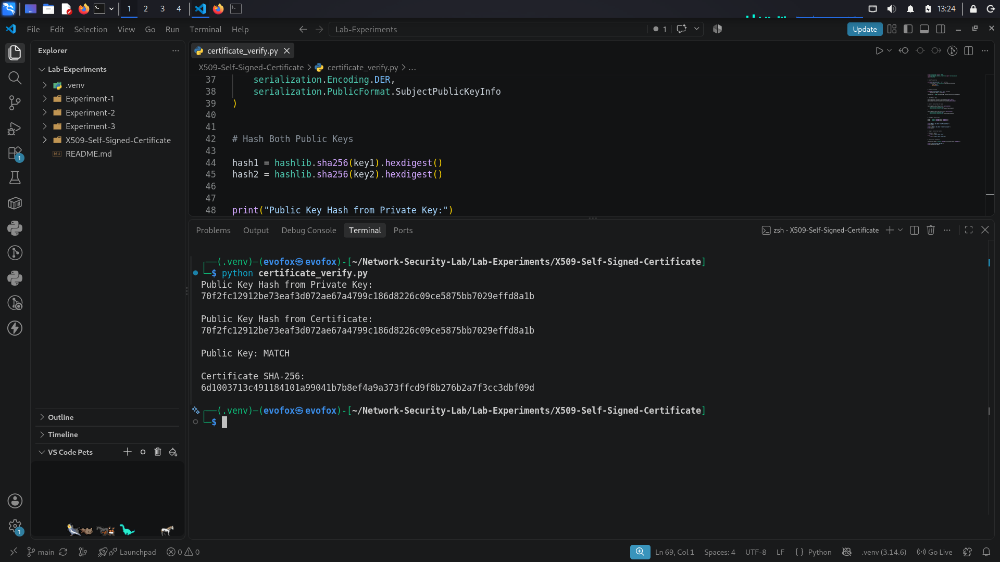
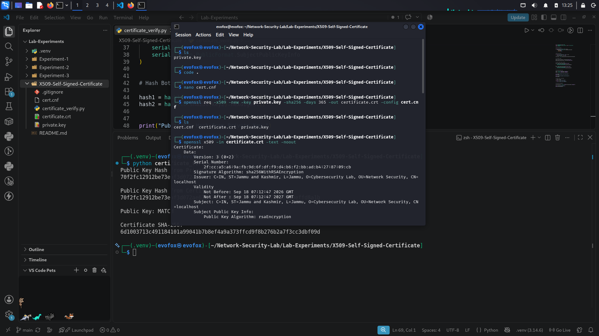
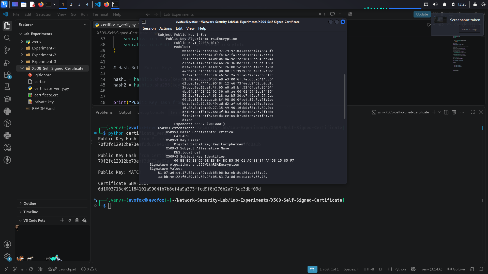
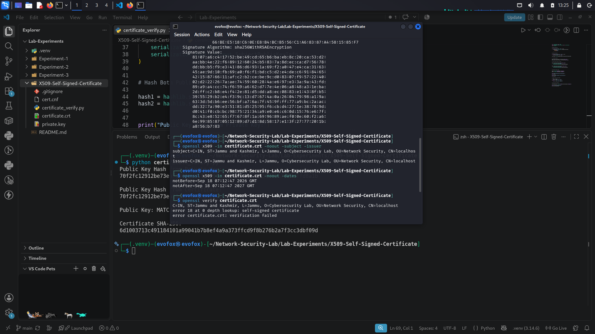

# Lab 04: X.509 Certificate Public Key Verification & PKI Analysis

## Overview
This laboratory examines Public Key Infrastructure (PKI) components by creating and auditing an **X.509 digital certificate**. Using OpenSSL and the Python `cryptography` library, the experiment proves cryptographic key pairing—verifying that the public key contained within an X.509 certificate derives mathematically from the corresponding private key—and examines certificate validation behavior.

---

## Technical Specifications

| Parameter | Specification |
| :--- | :--- |
| **Standard** | X.509 v3 (RFC 5280) |
| **Public Key Algorithm** | RSA 2048-bit |
| **Signature Algorithm** | `sha256WithRSAEncryption` |
| **Distinguished Name (DN)** | `C=IN, ST=Jammu and Kashmir, L=Jammu, O=Cybersecurity Lab, CN=localhost` |
| **Extensions Configured** | `basicConstraints=critical,CA:FALSE`, `keyUsage=digitalSignature,keyEncipherment`, `SAN=DNS:localhost` |
| **Source Scripts** | `certificate_verify.py`, `cert.cnf` |
| **Artifacts** | `certificate.crt`, `Screenshots/` (4 items) |

---

## Cryptographic Verification Architecture

```
┌────────────────────────────────┐         ┌────────────────────────────────┐
│   Private Key (private.key)    │         │  X.509 Cert (certificate.crt)  │
└────────────────────────────────┘         └────────────────────────────────┘
                 │                                         │
    Derive Public Key Object                  Extract Embedded Public Key
                 │                                         │
                 ▼                                         ▼
   Canonical DER Serialization               Canonical DER Serialization
      (SubjectPublicKeyInfo)                    (SubjectPublicKeyInfo)
                 │                                         │
          Compute SHA-256                           Compute SHA-256
                 │                                         │
                 ▼                                         ▼
     Hash: 70f2fc12912be73...                  Hash: 70f2fc12912be73...
                 │                                         │
                 └───────────────► MATCH ◄─────────────────┘
                         [Identity Authenticated]
```

---

## Laboratory Procedure

### 1. Certificate Configuration (`cert.cnf`)
A dedicated OpenSSL configuration file enforces standard X.509 v3 constraints:
- Disallows Certificate Authority privileges (`CA:FALSE`).
- Restricts key usage to digital signatures and asymmetric key encipherment.
- Specifies Subject Alternative Name (`DNS:localhost`).

### 2. Certificate Generation via OpenSSL
```bash
openssl req -x509 -new -key private.key -sha256 -days 365 -out certificate.crt -config cert.cnf
```

### 3. Automated Cryptographic Audit (`certificate_verify.py`)
```bash
python certificate_verify.py
```

#### Verification Terminal Output
```text
Public Key Hash from Private Key:
70f2fc12912be73eaf3d072ae67a4799c186d8226c09ce5875bb7029effd8a1b

Public Key Hash from Certificate:
70f2fc12912be73eaf3d072ae67a4799c186d8226c09ce5875bb7029effd8a1b

Public Key: MATCH

Certificate SHA-256:
6d1003713c491184101a99041b7b8ef4a9a373ffcd9f8b276b2a7f3cc3dbf09d
```

---

## Visual Evidence & Practical Observations

### Screenshot 1: Python Key Verification Execution
The Python script successfully parses both objects, normalizes the public keys to canonical DER byte streams, and verifies identical SHA-256 hashes.


### Screenshot 2: OpenSSL Request & Certificate Generation
The certificate signing request is fulfilled locally, outputting `certificate.crt` with a 365-day validity window.


### Screenshot 3: RSA Modulus & X.509v3 Extensions Inspection
Textual decoding of `certificate.crt` reveals the 2048-bit modulus, public exponent (`65537 / 0x10001`), and Subject Alternative Name extensions.


### Screenshot 4: Trust Chain Validation & Self-Signed Evaluation
Execution of `openssl verify certificate.crt` triggers:
```text
error 18 at 0 depth lookup: self-signed certificate
error certificate.crt: verification failed
```
This error demonstrates standard PKI trust chain verification: self-signed certificates must be explicitly pinned or installed into the trusted system certificate store to achieve trust validation.


---

## Security Best Practices Demonstrated
1. **Local Key Protection:** As seen in `.gitignore`, the private key file (`private.key`) is excluded from source control to avoid credential leakage.
2. **Canonical Hash Normalization:** Asymmetric keys are compared after serialization to standard ASN.1 `SubjectPublicKeyInfo` DER format, ensuring comparison is independent of formatting quirks.
3. **Immutability Auditing:** The overall certificate SHA-256 hash (`6d10037...`) serves as a cryptographic fingerprint for pinning and unauthorized alteration detection.
