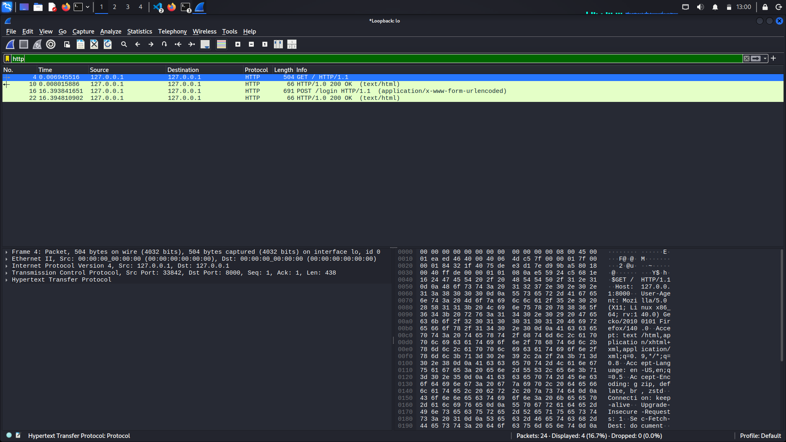
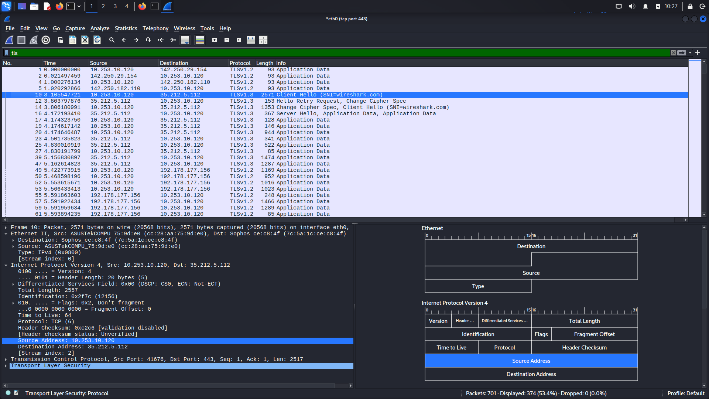
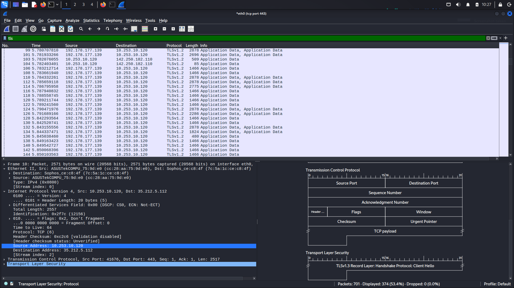
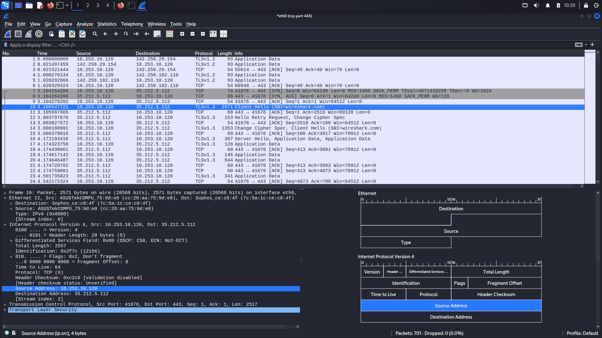
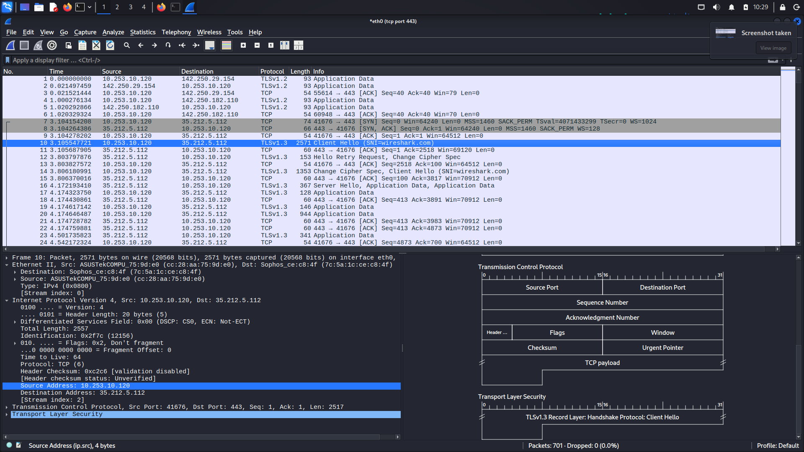

# Lab 05: Network Traffic Analysis with Wireshark (HTTP, TCP & TLSv1.3)

## Overview
This laboratory investigates network protocol communication and packet dissection using **Wireshark**. Through capture sessions on both local loopback (`lo`) and physical interfaces (`eth0`), the experiment evaluates the security differences between unencrypted application protocols (HTTP) and cryptographically secured transport protocols (TLS 1.2 / TLS 1.3).

---

## Technical Specifications

| Parameter | Plaintext Traffic Observation | Encrypted Transport Observation |
| :--- | :--- | :--- |
| **Interface** | Loopback (`lo`) | Ethernet (`eth0`) |
| **Protocols Analyzed** | HTTP/1.1, TCP | TCP, TLSv1.2, TLSv1.3 |
| **Ports** | `8000/TCP` (Local server) | `443/TCP` (HTTPS / Remote server) |
| **Target Host** | Localhost (`127.0.0.1`) | `wireshark.com` (`35.212.5.112`) |
| **Wireshark Filters** | `http` | `tls`, `tcp.port == 443` |
| **Security Risk Evaluated**| Cleartext eavesdropping & credential exposure | Packet inspection of encrypted payloads |

---

## Protocol Deep Dive & Forensic Analysis

### 1. Plaintext HTTP Traffic Vulnerability
When inspecting HTTP traffic over interface `lo`:
- The client issues an unencrypted `POST /login HTTP/1.1` request with content-type `application/x-www-form-urlencoded`.
- Request headers, user agents, cookies, and authentication payloads are directly readable in the packet dissection window and hex dump.
- **Risk:** Any intermediate entity (attacker on shared Wi-Fi, malicious router, ARP poisoner) can capture user credentials without decryption overhead.

### 2. TCP 3-Way Handshake & TLS 1.3 Session Establishment
Traffic analysis over `eth0` targeting port 443 illustrates the connection lifecycle:

```
Client (10.253.10.120:41676)                     Server (35.212.5.112:443)
      │                                                │
      │ ─── 1. TCP [SYN] Seq=0 ──────────────────────> │
      │ <── 2. TCP [SYN, ACK] Seq=0 Ack=1 ──────────── │
      │ ─── 3. TCP [ACK] Seq=1 Ack=1 ────────────────> │
      │                                                │
      │ ─── 4. TLS 1.3 Client Hello (SNI=wireshark) ─> │
      │ <── 5. TLS 1.3 Hello Retry Request ─────────── │
      │ ─── 6. TLS 1.3 Client Hello (Key Share) ─────> │
      │ <── 7. TLS 1.3 Server Hello, Finished ──────── │
      │ <================ Encrypted Traffic =========> │
```

---

## Visual Evidence & Forensic Observations

### Observation 1: Unencrypted HTTP Capture on Loopback
Inspection of frame 16 (`POST /login HTTP/1.1`) demonstrates cleartext payload exposure in Wireshark.


### Observation 2: TLS Protocol Dissection & Handshake Messages
Filtering by `tls` highlights session negotiation with `wireshark.com`, including `Client Hello`, `Hello Retry Request`, and transition to encrypted `Application Data`.


### Observation 3: High-Throughput Encrypted Application Records
Demonstrates continuous payload encryption: packets traveling between client and remote hosts remain confidential as opaque `Application Data` buffers.


### Observation 4: TCP 3-Way Handshake Prior to TLS Initiation
Unfiltered inspection confirms packets 7, 8, and 9 establishing the underlying TCP state machine (`SYN`, `SYN-ACK`, `ACK`) before the cryptographic handshake commences.


### Observation 5: Packet Header Dissection Details
Detailed packet hierarchy breakdown across Ethernet II, IPv4 (TTL=64, Don't Fragment flag), TCP, and Transport Layer Security layers.


---

## Security Takeaways
- **Mandatory Transport Encryption:** Plaintext protocols (HTTP, Telnet, FTP) provide zero confidentiality; all modern services must enforce TLS with strict cipher suites.
- **TLS 1.3 Efficiency & Security:** Compared to TLS 1.2, TLS 1.3 removes legacy vulnerable ciphers (e.g., RC4, static RSA key exchange) and accelerates session setup with 1-RTT handshake negotiation.
