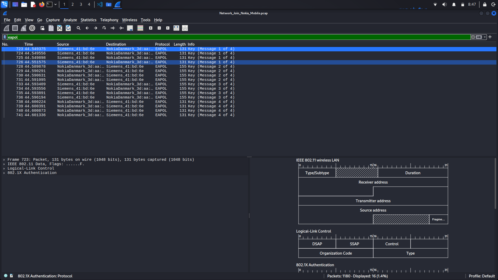
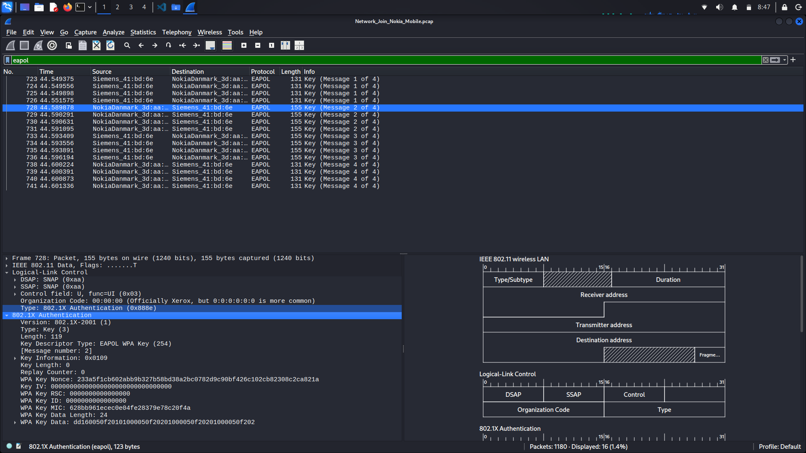
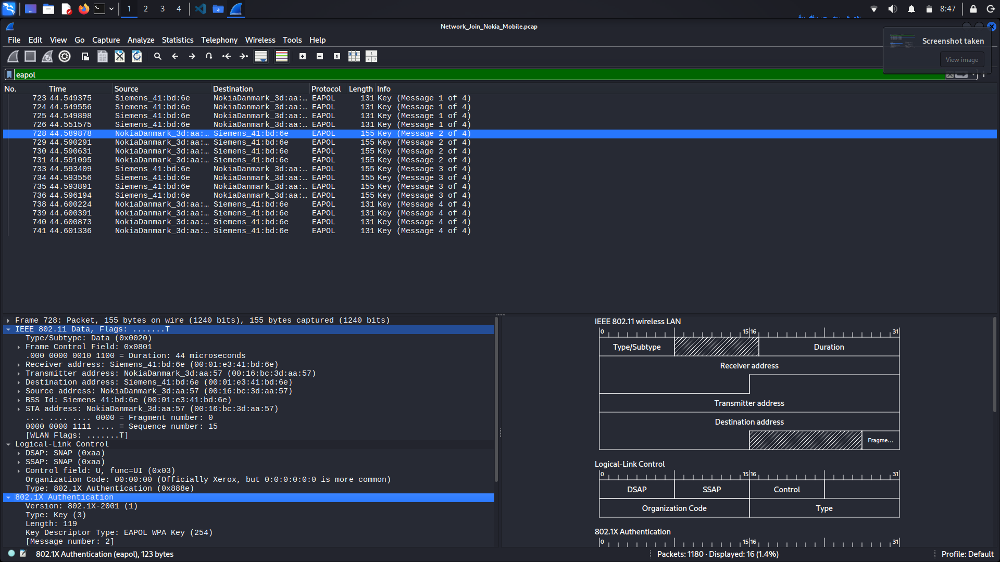
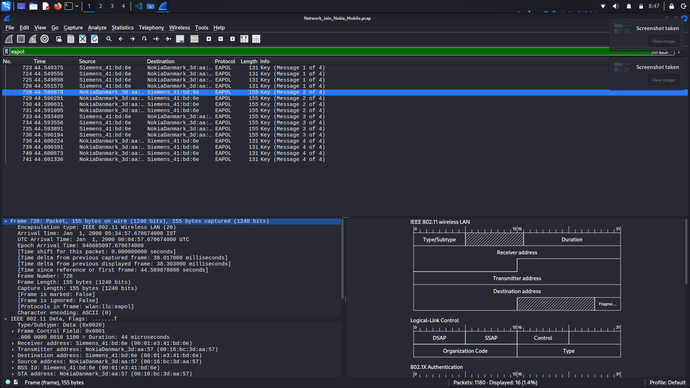

# Lab 07: IEEE 802.11i / WPA2 4-Way Handshake Analysis

## Overview
This laboratory conducts an in-depth protocol analysis of the **IEEE 802.11i / WPA2 4-Way Handshake**. Using both a custom automated Python packet parser (`wpa2_analyzer.py` built on Scapy) and Wireshark forensic inspection, this experiment unpacks the derivation and verification of the **Pairwise Transient Key (PTK)** from packet capture artifacts (`wpa2-four-way-handshake.pcap`).

---

## Technical Specifications

| Parameter | Specification |
| :--- | :--- |
| **Standard** | IEEE 802.11i / WPA2-Personal (PSK) |
| **Key Encapsulation** | EAPOL-Key (EAP over LAN, Type 3, Descriptor 254) |
| **Authentication Parties** | Access Point (`Siemens_41:bd:6e`) &amp; Mobile Client (`NokiaDanmark_3d:aa:57`) |
| **Capture Source** | `wpa2-four-way-handshake.pcap` (1,180 total frames, 16 EAPOL frames) |
| **Core Parser** | `wpa2_analyzer.py` (Scapy, Python 3) |
| **Visual Evidence** | 4 High-Resolution Wireshark Dissection Captures |

---

## Cryptographic Key Derivation Flow

```
                      Pre-Shared Key (Passphrase + SSID)
                                      │
                                      ▼
                      Pairwise Master Key (PMK)
                                      │
           ┌──────────────────────────┴──────────────────────────┐
           │                                                     │
Access Point (Siemens)                                  Client (NokiaDanmark)
  [Generates ANonce]                                     [Generates SNonce]
           │                                                     │
           │ ─── 1. Message 1: ANonce (Ack=1, MIC=0) ──────────> │
           │                                                     │
           │                                            [Derive PTK via PRF]
           │                                            [Calculate MIC]
           │ <── 2. Message 2: SNonce + MIC (Ack=0, MIC=1) ──── │
           │                                                     │
  [Derive PTK via PRF]                                           │
  [Verify Message 2 MIC]                                         │
  [Derive GTK]                                                   │
           │                                                     │
           │ ─── 3. Message 3: Install PTK + GTK (Ack=1, MIC=1)> │
           │                                                     │
           │                                            [Install PTK & GTK]
           │ <── 4. Message 4: Final ACK (Ack=0, MIC=1) ─────── │
           │                                                     │
     [Handshake Complete: Authenticated & Encrypted CCMP Data Frames Begin]
```

---

## Parser Architecture (`wpa2_analyzer.py`)

The custom script executes deep packet parsing without relying on external GUI tools:
1. **Frame Demuxing:** Reads raw PCAP streams via Scapy's `rdpcap()` and filters for 802.1X `EAPOL` layers with key descriptor type 254.
2. **Bitmask Extraction:** Decodes 16-bit Key Information bitfields:
   - `Ack` bit (`0x0080`): Set by the Authenticator (AP).
   - `MIC` bit (`0x0100`): Indicates message integrity check validation.
   - `Install` bit (`0x0040`): Instructs station to install the PTK.
3. **Signature Fingerprinting:** Tracks tuples of `(Transmitter, Receiver, ReplayCounter, KeyInfo, Nonce, MIC)` to differentiate new handshake messages from 802.11 wireless retransmissions.
4. **ANonce Consistency:** Verifies that ANonce values delivered in Message 1 and Message 3 remain consistent throughout the association window.

---

## Execution Guide

### Running the Scapy Analyzer
```bash
python wpa2_analyzer.py wpa2-four-way-handshake.pcap
```

### Analysis Output Summary
```text
============================================================
ANALYSIS SUMMARY
============================================================
Total EAPOL-Key Frames: 16

Message 1
Captured Frames: 4
Unique Variants: 1

Message 2
Captured Frames: 4
Unique Variants: 1

Message 3
Captured Frames: 4
Unique Variants: 1

Message 4
Captured Frames: 4
Unique Variants: 1

Duplicate / Retransmitted Frames: 12

SUCCESS: All four handshake message types detected.
ANonce Verification: Matching values detected.
```

---

## Wireshark Forensic Evidence

### 1. EAPOL Handshake Overview
Wireshark filter `eapol` isolates the full four-way exchange between the Siemens AP and Nokia station, illustrating initial frames and wireless retransmissions.


### 2. Message 2 Dissection (SNonce & MIC)
Inspection of frame 728 shows the client transmitting its generated `SNonce` along with the computed `WPA Key MIC` (Message Integrity Code) validating possession of the PMK.


### 3. IEEE 802.11 MAC Frame Attributes
Verification of 802.11 frame control fields, transmitter address (`00:16:bc:3d:aa:57`), receiver BSSID (`00:01:e3:41:bd:6e`), and sequence parameters.


### 4. Frame Timing & Retransmission Analysis
Examination of arrival timestamps and inter-packet intervals confirms retransmission bursts typical of noisy RF environments before successful acknowledgments.


---

## Defensive & Offensive Cybersecurity Context
- **Offline Dictionary Attacks:** If an attacker captures all 4 messages (or just Messages 1 and 2), the PTK derivation can be simulated offline against a dictionary/wordlist without interacting further with the target network.
- **WPA3 Improvements (SAE):** Contemporary WPA3 networks replace the 4-way PSK exchange with Simultaneous Authentication of Equals (SAE), preventing offline dictionary attacks even when handshakes are intercepted.
