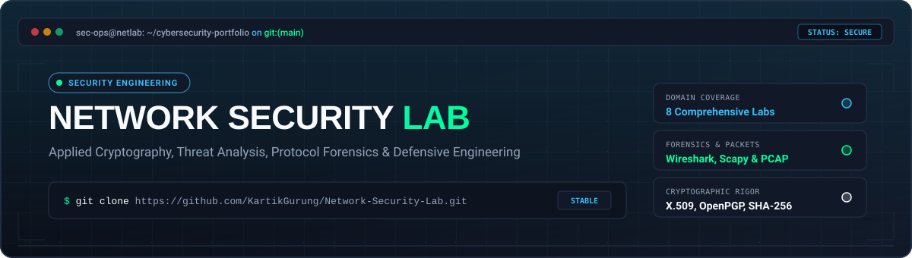
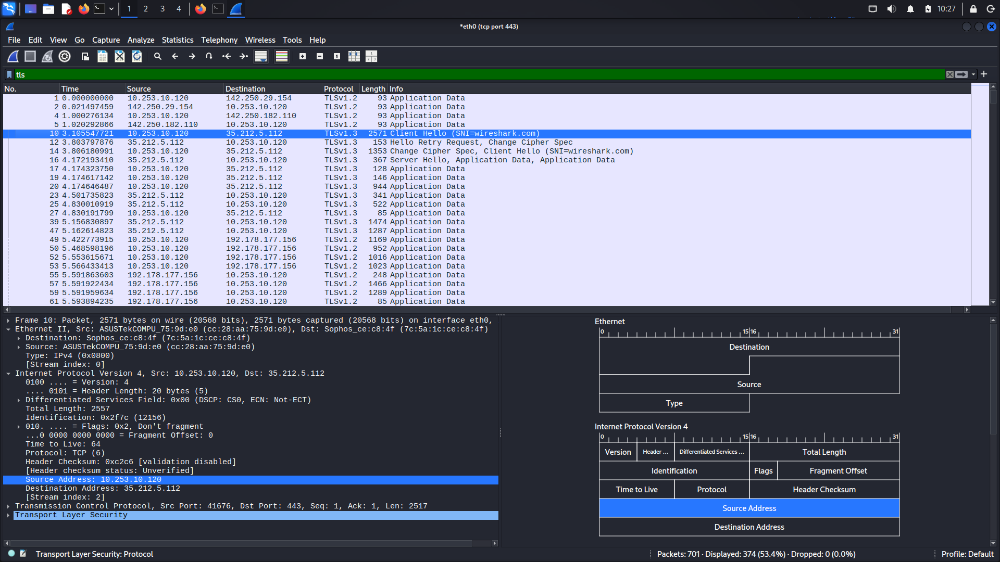
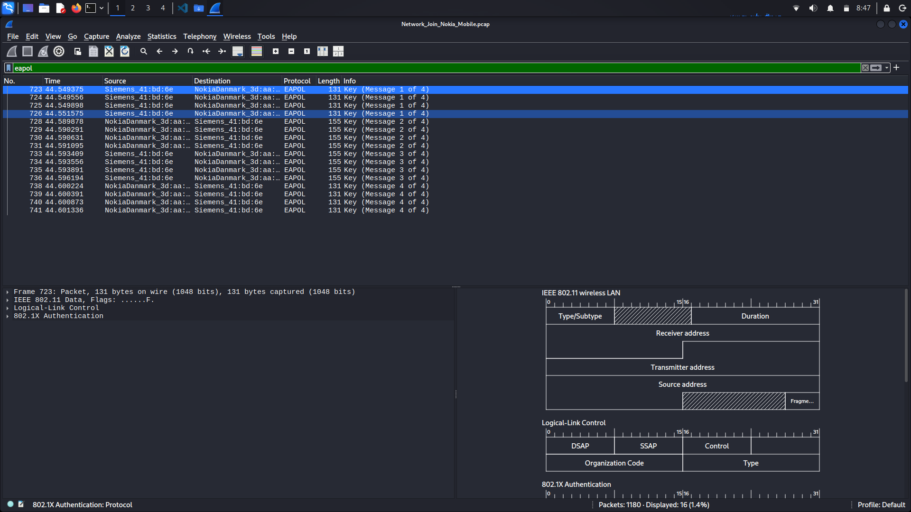
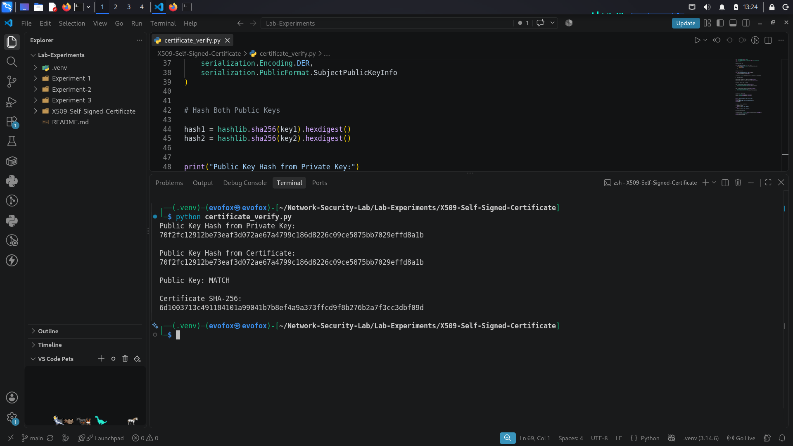

<div align="center">



# NETWORK SECURITY LABORATORY

**An Advanced Engineering Portfolio in Applied Cryptography, Protocol Analysis, Identity Systems &amp; Wireless Security**

[](https://www.python.org/)
[](https://fastapi.tiangolo.com/)
[](https://scapy.net/)
[](https://cryptography.io/)
[](https://www.wireshark.org/)
[](https://www.kernel.org/)
[](https://www.openpgp.org/)
[](LICENSE)

<p align="center">
  <a href="#about-the-portfolio">About</a> •
  <a href="#technical-matrix">Laboratory Matrix</a> •
  <a href="#experiment-deep-dives">Experiments</a> •
  <a href="#forensic-evidence--visual-gallery">Forensic Gallery</a> •
  <a href="#repository-architecture">Architecture</a> •
  <a href="#quickstart--reproduction">Quickstart</a> •
  <a href="#ethical-use-disclaimer">Ethical Use</a>
</p>

</div>

---

## About the Portfolio

The **Network Security Laboratory** is an academic cybersecurity repository demonstrating practical principles across cryptography, network protocol forensics, authentication mechanisms, and defensive systems engineering.

Rather than relying purely on theoretical models, this repository bridges theoretical cryptography with hands-on systems analysis:
- **Applied Cryptography:** Modular arithmetic ciphers, cryptographic hash functions (SHA-256), and public key infrastructure (RSA 2048 / X.509).
- **Identity & Access Verification:** Challenge-response authentication protocols, replay attack defense mechanisms, and RESTful authentication prototyping.
- **Protocol Forensics & Traffic Inspection:** Deep packet inspection with Wireshark and Scapy across Layer 2 (802.11 / EAPOL), Layer 4 (TCP), and Layer 7 (HTTP / TLS 1.3 / SSH).
- **End-to-End Secure Communications:** OpenPGP asymmetric key exchange, trusted fingerprint validation, digital signing, and file integrity controls.

---

## Technical Stack & Tooling

| Domain | Primary Tools & Frameworks | Practical Application in Lab |
| :--- | :--- | :--- |
| **Core Programming** | Python 3 | Algorithmic implementations, automated packet dissecting, and cryptographic validation |
| **Asymmetric PKI** | `cryptography` (hazmat, x509) | Loading PEM certificates, extracting SPKI DER bytes, and verifying public key pairs |
| **Packet Forensics** | Scapy, Wireshark | 802.11 frame carving, EAPOL-Key bitfield parsing, and TCP/TLS inspection |
| **Cryptographic Hashing** | Python `hashlib` | SHA-256 baseline hashing, tamper discovery, and digest generation |
| **Microservice Prototyping** | FastAPI, Uvicorn | Ephemeral nonce challenge-response API service (`/user`) |
| **Secure Administration** | OpenSSH, SSH-2.0 | Encrypted remote terminal management, host key verification, and auditing |
| **Email Security** | Mozilla Thunderbird, OpenPGP | Asymmetric keypair generation, web-of-trust fingerprint auditing, and hybrid encryption |
| **Audit Environment** | Kali Linux, Metasploitable 2 | Controlled forensic capture environment and target testing systems |

---

## Technical Matrix

| # | Experiment Module | Domain Focus | Primary Technologies | Direct Link |
| :---: | :--- | :--- | :--- | :---: |
| **01** | [Classical Encryption](Experiment-1/) | Substitution & Polyalphabetic Ciphers | Python 3, Modular Math | [Documentation](Experiment-1/README.md) |
| **02** | [SHA-256 Data Integrity](Experiment-2/) | Cryptographic Hashing & Avalanche Effect | Python, `hashlib`, SHA-256 | [Documentation](Experiment-2/README.md) |
| **03** | [Challenge-Response Auth](Experiment-3/) | Replay Attack Mitigation & REST Tokenization | Python, FastAPI, Uvicorn | [Documentation](Experiment-3/README.md) |
| **04** | [X.509 Certificate Verification](Experiment-4/) | Public Key Infrastructure & DER Serialization | OpenSSL, `cryptography`, RSA | [Documentation](Experiment-4/README.md) |
| **05** | [Traffic Analysis (HTTP & TLS)](Experiment-5/) | Packet Dissection & Handshake Forensics | Wireshark, TCP, TLSv1.3, HTTP | [Documentation](Experiment-5/README.md) |
| **06** | [SSH Protocol Auditing](Experiment-6/) | Encrypted Administration & Host Keys | OpenSSH, Kali Linux, Metasploitable | [Documentation](Experiment-6/README.md) |
| **07** | [WPA2 4-Way Handshake](Experiment-7/) | EAPOL-Key Parsing & PTK Derivation | Scapy, 802.11i, Wireshark, PCAP | [Documentation](Experiment-7/README.md) |
| **08** | [OpenPGP End-to-End Email](Experiment-8/) | Asymmetric Key Exchange & Digital Signatures | Thunderbird, OpenPGP, RFC 4880 | [Documentation](Experiment-8/README.md) |

---

## Experiment Deep-Dives

### 01. Classical Encryption Techniques
- **Source:** [`Experiment-1/exp-1.py`](Experiment-1/exp-1.py)
- **Technical Scope:** Implements the Caesar cipher ($C = (P + k) \pmod{26}$) and Vigenère polyalphabetic cipher ($C_i = (P_i + K_{i \pmod m}) \pmod{26}$).
- **Security Relevance:** Demonstrates the mathematical foundation of substitution ciphers while analyzing their vulnerability to frequency analysis, brute force, and the Kasiski test.
- [Read Lab 01 Documentation →](Experiment-1/README.md)

### 02. SHA-256 Cryptographic Integrity
- **Source:** [`Experiment-2/exp-2.py`](Experiment-2/exp-2.py) | [`Experiment-2/sample.txt`](Experiment-2/sample.txt)
- **Technical Scope:** Computes a 256-bit hash baseline over an initial payload, introduces an isolated character modification, and recomputes the digest to prove tamper detection.
- **Security Relevance:** Illustrates the avalanche effect—where a microscopic alteration completely randomizes the 64-character hexadecimal digest, upholding data integrity.
- [Read Lab 02 Documentation →](Experiment-2/README.md)

### 03. Challenge-Response Authentication & Replay Prevention
- **Source:** [`Experiment-3/exp-3.py`](Experiment-3/exp-3.py) | [`Experiment-3/exp-3_improvement.py`](Experiment-3/exp-3_improvement.py)
- **Technical Scope:** Models zero-knowledge shared-secret verification using ephemeral nonces. Includes both a CLI simulation demonstrating replay rejection and a FastAPI prototype.
- **Security Relevance:** Eliminates cleartext credential transmission over untrusted media and invalidates stale intercepted responses through non-repeating challenges.
- [Read Lab 03 Documentation →](Experiment-3/README.md)

### 04. X.509 Public Key Certificate Verification
- **Source:** [`Experiment-4/certificate_verify.py`](Experiment-4/certificate_verify.py) | [`Experiment-4/cert.cnf`](Experiment-4/cert.cnf) | [`Experiment-4/certificate.crt`](Experiment-4/certificate.crt)
- **Technical Scope:** Custom OpenSSL configuration generating an RSA-2048 X.509 v3 certificate. A Python verification script serializes public keys from both private key and certificate into canonical DER SubjectPublicKeyInfo format to verify cryptographic pairing.
- **Security Relevance:** Validates certificate integrity, Subject Alternative Names (SAN), and demonstrates PKI trust path mechanics.
- [Read Lab 04 Documentation →](Experiment-4/README.md)

### 05. Wireshark Network Traffic Analysis
- **Source:** Captured visual sessions in [`Experiment-5/`](Experiment-5/)
- **Technical Scope:** Comparative packet capture auditing on local loopback (`lo`) and physical interfaces (`eth0`). Dissects unencrypted HTTP request/response sequences versus TLS 1.3 encrypted sessions.
- **Security Relevance:** Uncovers plaintext credentials exposed via `POST /login` over HTTP and examines TCP three-way handshake (`SYN` $\rightarrow$ `SYN-ACK` $\rightarrow$ `ACK`) and TLS 1.3 Client Hello / Server Hello negotiations.
- [Read Lab 05 Documentation →](Experiment-5/README.md)

### 06. SSH Protocol Auditing & Remote Administration
- **Source:** Photographic evidence in [`Experiment-6/`](Experiment-6/)
- **Technical Scope:** Secure remote management session initiated from Kali Linux to an audit host (Metasploitable 2) using OpenSSH with legacy RSA host key negotiation.
- **Security Relevance:** Explores encrypted shell operation, host key fingerprint pinning, mutual authentication, and modern post-quantum key exchange migration warnings.
- [Read Lab 06 Documentation →](Experiment-6/README.md)

### 07. WPA2 4-Way Handshake Analysis
- **Source:** [`Experiment-7/wpa2_analyzer.py`](Experiment-7/wpa2_analyzer.py) | [`Experiment-7/wpa2-four-way-handshake.pcap`](Experiment-7/wpa2-four-way-handshake.pcap)
- **Technical Scope:** Custom Scapy analyzer script parsing raw 802.11 packet captures. Identifies EAPOL-Key bitmasks (`Ack`, `MIC`, `Install`), extracts ANonce/SNonce pairs, tracks replay counters, detects frame retransmissions, and confirms handshake completeness.
- **Security Relevance:** Evaluates the derivation of the Pairwise Transient Key (PTK) and details defensive implications against offline dictionary attacks.
- [Read Lab 07 Documentation →](Experiment-7/README.md)

### 08. OpenPGP End-to-End Email & Attachment Security
- **Source:** [`Experiment-8/README.md`](Experiment-8/README.md) | Exchanged Keys in [`Experiment-8/Outputs/`](Experiment-8/Outputs/)
- **Technical Scope:** Full public key infrastructure implementation within Mozilla Thunderbird. Demonstrates primary password protection, asymmetric key pair generation, out-of-band fingerprint auditing, encrypted email transmission, and digital signature validation.
- **Security Relevance:** Guarantees confidentiality, authenticity, and non-repudiation for message bodies and sensitive file attachments (`confidential.txt`).
- [Read Lab 08 Documentation →](Experiment-8/README.md)

---

## Forensic Evidence & Visual Gallery

### Packet Inspection & Wireless Protocol Analysis
| Lab 05: HTTP vs TLS Dissection | Lab 07: WPA2 EAPOL Handshake Inspection |
| :---: | :---: |
|  |  |
| *Wireshark dissection of TLS 1.3 Client Hello and session negotiation.* | *Detection of EAPOL-Key 4-Way exchange and wireless retransmissions.* |

### Cryptographic Key Verification & Auditing
| Lab 04: X.509 SPKI Public Key Verification | Lab 06: Kali Linux Remote SSH Session |
| :---: | :---: |
|  |  |
| *Automated Python public-key matching between private key and certificate.* | *Encrypted OpenSSH terminal connection and command execution.* |

---

## Repository Architecture

```text
Network-Security-Lab/
├── assets/
│   └── banner.svg                  # Dark technical repository banner
├── requirements.txt                # Python environment dependency manifest
├── .gitignore                      # Comprehensive security & environment ignore rules
├── LICENSE                         # Permissive MIT open-source license
├── README.md                       # Master portfolio documentation
│
├── Experiment-1/                   # Module 01: Classical Encryption Techniques
│   ├── README.md                   # Lab guide & cryptanalysis
│   └── exp-1.py                    # Caesar & Vigenère cipher implementation
│
├── Experiment-2/                   # Module 02: Cryptographic Hashing & Integrity
│   ├── README.md                   # Lab guide & avalanche effect analysis
│   ├── exp-2.py                    # SHA-256 hash generator & tamper validator
│   └── sample.txt                  # Monitored integrity test file
│
├── Experiment-3/                   # Module 03: Challenge-Response Authentication
│   ├── README.md                   # Lab guide & protocol interaction flows
│   ├── exp-3.py                    # Console challenge-response & replay simulator
│   └── exp-3_improvement.py        # FastAPI REST challenge generation endpoint
│
├── Experiment-4/                   # Module 04: X.509 Certificate Verification
│   ├── README.md                   # Lab guide & OpenSSL PKI documentation
│   ├── cert.cnf                    # OpenSSL certificate configuration
│   ├── certificate.crt             # Generated X.509 public key certificate
│   ├── certificate_verify.py       # Python SPKI hash comparison & cert auditor
│   └── Screenshots/                # Terminal verification visual evidence (4 images)
│
├── Experiment-5/                   # Module 05: Network Traffic Analysis
│   ├── README.md                   # Lab guide, packet dissection & filters
│   └── Screenshot_*.png            # Wireshark HTTP, TCP & TLS captures (5 images)
│
├── Experiment-6/                   # Module 06: Secure Shell (SSH) Analysis
│   ├── README.md                   # Lab guide & remote administration audit
│   └── WhatsApp Image *.jpeg       # Kali Linux OpenSSH terminal evidence (2 images)
│
├── Experiment-7/                   # Module 07: WPA2 Handshake Analysis
│   ├── README.md                   # Lab guide & PTK cryptographic derivation
│   ├── wpa2_analyzer.py            # Automated Scapy EAPOL packet analyzer
│   ├── wpa2-four-way-handshake.pcap # Captured 802.11i wireless handshake trace
│   └── Screenshot_*.png            # Wireshark wireless analysis evidence (4 images)
│
└── Experiment-8/                   # Module 08: OpenPGP Secure Email Communication
    ├── README.md                   # Lab writeup, procedures & key exchange notes
    └── Outputs/                    # Exchanged public keys (.asc) & evidence (8 images)
```

---

## Quickstart & Reproduction

### 1. Environment Setup
Clone the repository and install the verified dependencies:
```bash
git clone https://github.com/KartikGurung/Network-Security-Lab.git
cd Network-Security-Lab
python -m pip install -r requirements.txt
```

### 2. Running Individual Experiments

#### Run Classical Cryptography (Lab 01)
```bash
python Experiment-1/exp-1.py
```

#### Test Hash Tamper Detection (Lab 02)
```bash
python Experiment-2/exp-2.py
```

#### Run Challenge-Response Replay Simulation (Lab 03)
```bash
python Experiment-3/exp-3.py
```

#### Start FastAPI Authentication Prototype (Lab 03)
```bash
uvicorn Experiment-3.exp-3_improvement:app --reload --port 8000
```

#### Execute X.509 Key Verification (Lab 04)
*(Note: Requires local `private.key` generated during certificate creation)*
```bash
cd Experiment-4
python certificate_verify.py
```

#### Analyze WPA2 4-Way Handshake PCAP (Lab 07)
```bash
cd Experiment-7
python wpa2_analyzer.py wpa2-four-way-handshake.pcap
```

---

## Professional Competencies Demonstrated

- **Defensive Engineering:** Understanding algorithmic vulnerabilities in classical substitution and applying modern one-way hash primitives.
- **Protocol Forensics:** Dissecting raw network traffic across Layer 2 (802.11 / EAPOL), Layer 4 (TCP), and Layer 7 (HTTP / TLS 1.3 / SSH).
- **PKI Architecture:** Validating public key serialization, certificate lifecycle management, SAN extensions, and trust-chain resolution.
- **Identity & Access Management:** Designing replay-resistant authentication using freshness nonces and shared secrets.
- **Secure Communication:** Implementing end-to-end PGP email and attachment encryption with out-of-band fingerprint verification.

---

## Technical References

- **NIST FIPS 180-4:** Secure Hash Standard (SHS / SHA-256)
- **RFC 5280:** Internet X.509 Public Key Infrastructure Certificate and CRL Profile
- **RFC 8446:** The Transport Layer Security (TLS) Protocol Version 1.3
- **RFC 4880 / RFC 9580:** OpenPGP Message Format Specification
- **IEEE Std 802.11i-2004:** Medium Access Control (MAC) Security Enhancements

---

## Ethical Use Disclaimer

> [!IMPORTANT]
> The scripts, packet captures, and procedures contained in this repository are developed strictly for authorized academic research, educational study, and defensive cybersecurity operations.
>
> All testing, network monitoring, and session analyses were conducted within isolated private laboratory environments, virtual machines, or against systems with explicit authorization. Do not execute packet inspection, wireless sniffing, or authentication testing against networks, devices, or communication channels without verified authorization from the system owner.

---

## License & Attribution

This project is licensed under the **MIT License** — see the [LICENSE](LICENSE) file for complete details.

**Author / Maintainer:** [Kartik Gurung](https://github.com/KartikGurung)
```text
Portfolio Status: Active & Documented
Primary Focus: Network Security, Applied Cryptography & Defensive Systems
```
